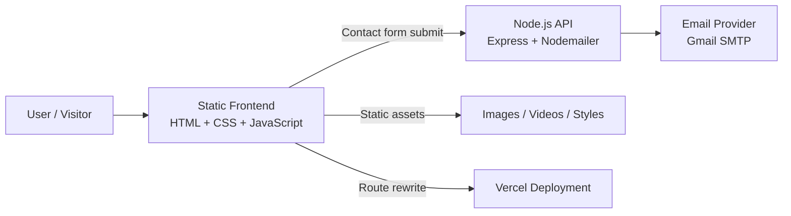

# 🚀 SwiftCare

     

SwiftCare is a responsive business website for a professional services brand, combining a polished static marketing experience with a small Node.js email API for contact form submissions. It is designed to present service offerings, industry coverage, company information, legal pages, testimonials, and a clear call to action for prospective clients. Technically, the project is interesting because it blends a static frontend with server-side email handling, environment-based configuration, and deployment rewrites for a production-friendly contact flow.

## ✨ Key Highlights

- Responsive multi-page marketing website with desktop and mobile navigation
- Hero video slider, card carousels, animated counters, and tabbed content sections
- Industry-focused service presentation for healthcare, real estate, legal, and retail/e-commerce audiences
- Dedicated legal pages for Terms & Privacy
- Contact form email delivery via a Node.js + Express backend using Nodemailer
- Vercel rewrite configured for `/api/send-email`
- No database, auth system, AI model, RAG pipeline, or agent framework is implemented in this repository

## 🎯 Problem Statement

Many small business websites do a poor job of balancing visual polish, clarity, and lead capture. They may look attractive but fail to communicate services clearly or provide a reliable contact path for inbound inquiries. SwiftCare addresses that gap by providing a professional web presence that showcases services, builds trust through testimonials and industry positioning, and routes contact requests through email.

## 💡 Solution

SwiftCare solves this with a structured static frontend and a lightweight backend email endpoint:

- The frontend presents the brand, services, industries, testimonials, and legal information in a clean, responsive layout.
- The backend accepts contact form submissions and sends them to a configured recipient email address.
- Deployment routing is simplified through Vercel rewrites so the contact endpoint is available at a clean API path.

## 🧠 AI / GenAI Capabilities

There are no implemented AI, LLM, RAG, agent, embedding, vector database, retrieval, reranking, or tool-calling components in the current codebase.

The repository does mention “AI” in marketing copy and navigation labels, but that is part of the site’s business messaging rather than an implemented machine learning system.

## 🏗️ System Architecture



### Components

- **User / Visitor**: Browses the marketing site, reads service pages, and submits the contact form.
- **Static Frontend**: The main experience built from HTML, CSS, and JavaScript. It includes navigation, hero media, sliders, counters, and service pages.
- **Node.js API**: `api/index.js` exposes `/api/send-email` and sends form submissions through Nodemailer.
- **Email Provider**: Gmail SMTP is used for outbound email delivery.
- **Static Assets**: Images, videos, and stylesheets are served from the repository.
- **Vercel Deployment**: `vercel.json` rewrites `/api/send-email` to the serverless function file.

## 🔄 How It Works

1. A visitor loads the homepage or one of the service/legal pages.
2. JavaScript powers the desktop dropdowns, mobile menu, hero slider, card slider, and counters.
3. The user submits the contact form.
4. The backend receives the request at `/api/send-email`.
5. The API validates the payload at a basic level and creates a Nodemailer transporter.
6. The message is sent using Gmail credentials from environment variables.
7. The API returns a success or error response to the client.

## 🛠️ Tech Stack

| Category | Technology | Purpose |
|---|---|---|
| Frontend | HTML5 | Page structure and content |
| Frontend | CSS3 | Layout, responsive styling, and visual design |
| Frontend | Vanilla JavaScript | Menu behavior, sliders, counters, and interactions |
| Backend | Node.js | Runtime for the email API |
| Backend | Express.js | HTTP server and API routing |
| Email | Nodemailer | Sends contact form emails |
| Email | Gmail SMTP | Mail transport service |
| Configuration | dotenv | Environment variable loading |
| Infrastructure | Vercel | Deployment and API rewrite support |

## 📁 Project Structure

```text
.
├── api/
│   ├── index.js
│   └── send-email.js
├── css/
│   ├── legal.css
│   ├── industries.css
│   └── services.css
├── images/
├── js/
│   ├── main.js
│   └── services.js
├── pages/
│   ├── privacy.html
│   ├── terms.html
│   └── services/
├── videos/
├── index.html
├── package.json
├── vercel.json
└── README.md
```

## 🖥️ Frontend Features

### Navigation and layout
- Fixed desktop navigation with mega menus
- Mobile off-canvas navigation with expandable sections
- Strong visual branding and CTA placement

### Homepage experience
- Hero video slideshow with controls and autoplay fallback handling
- Horizontal card carousel for service/industry highlights
- Tabbed content section for Technology, Outsourcing, and People
- Company story section and animated counters
- Testimonial carousel-style presentation
- Partner logo showcase
- Footer with contact and policy links

### Service and legal pages
- Dedicated service pages for:
  - Inbound Call Handling
  - Appointment & Reservation
  - Urgent Issue Escalation
  - Customer Follow-Up
  - Information & FAQ Support
  - After-Hours Coverage
- Privacy Policy page
- Terms & Conditions page

## 🧩 Backend Features

- `POST /api/send-email` email submission endpoint
- CORS enabled for browser-based form submissions
- Environment-based email credentials via `.env`
- Recipient address configurable through `RECIPIENT_EMAIL`
- Basic request validation in `api/send-email.js`
- Local development mode supported through `api/index.js`

## 🔐 Authentication & Authorization

No authentication or authorization layer is implemented. The repository currently operates as a public marketing site with an open contact form endpoint.

## 🗄️ Database

No database is configured or used in the current implementation.

## 🤖 AI / RAG / Agent Status

| Capability | Status | Notes |
|---|---|---|
| LLM integration | Not implemented | No model calls found |
| RAG pipeline | Not implemented | No retrieval layer or vector store |
| Agent architecture | Not implemented | No agent orchestration code |
| Embeddings | Not implemented | None present |
| Vector database | Not implemented | None present |
| Tool calling | Not implemented | None present |
| Memory | Not implemented | None present |

## ⚙️ Environment Variables

The email API expects the following environment variables:

```bash
EMAIL_USER=
EMAIL_PASS=
RECIPIENT_EMAIL=
PORT=
```

- `EMAIL_USER` — Gmail account used for SMTP authentication
- `EMAIL_PASS` — App password or SMTP password
- `RECIPIENT_EMAIL` — Destination address for contact submissions
- `PORT` — Local server port, defaulting to `3000` if not set

## 🚀 Running Locally

### Prerequisites
- Node.js 18+ recommended
- npm
- Gmail account with SMTP/app-password access

### Install

```bash
npm install
```

### Start the server

```bash
npm start
```

The app starts the Express server defined in `api/index.js` and serves the site locally.

## 📦 Deployment Notes

- The repository includes `vercel.json` for deployment routing.
- `/api/send-email` is rewritten to `/api/send-email.js`.
- The site is otherwise static and can be deployed to any static host with Node/serverless support for the email endpoint.

## 🧪 Tests

No automated test suite is currently implemented. The existing `npm test` script is a placeholder.

## 📄 Documentation

The repository currently contains a README, but it has been rewritten here to more accurately reflect the actual codebase.

## ✅ What This Project Is Best For

- A portfolio-ready business website
- A modern service landing page
- Demonstrating frontend layout, interactivity, and content architecture
- Showing a simple but production-minded contact email flow

## 📌 Notes

- Several marketing claims and brand statements are present in the site copy; this README only describes what is actually implemented in code.
- Some menu links reference pages that are not included in the snippets above, so this README intentionally avoids claiming functionality not directly verified in the repository.

## 📬 Contact

For site inquiries, the footer lists:

- `hello@swiftcaresolution.net`
- `+92 309 4163143`

---

Built to present SwiftCare as a polished, credible, and technically grounded business website.